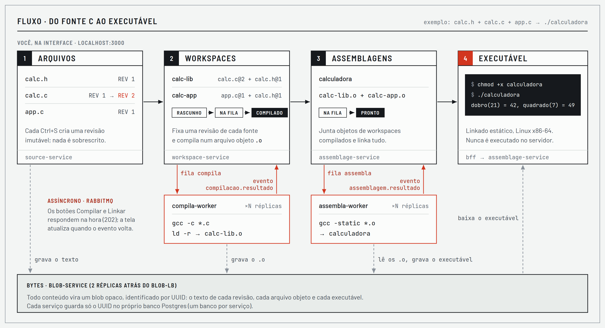
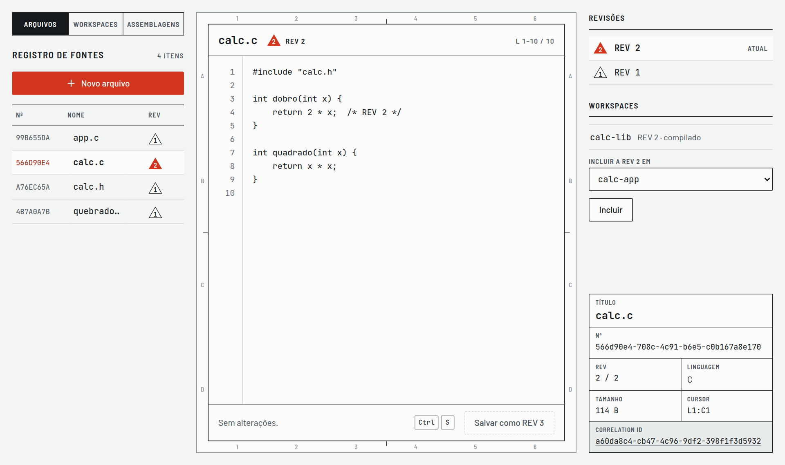
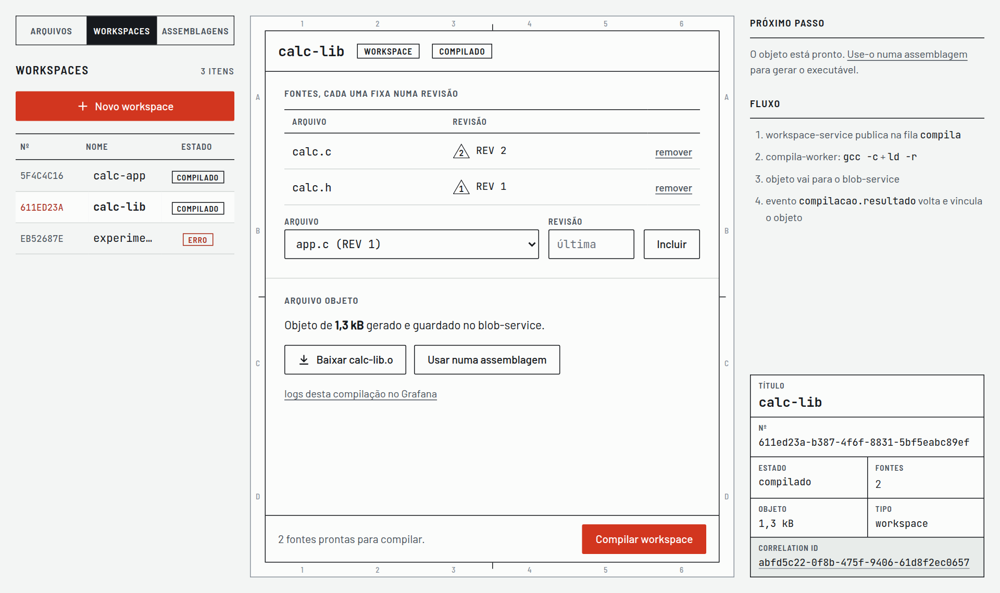
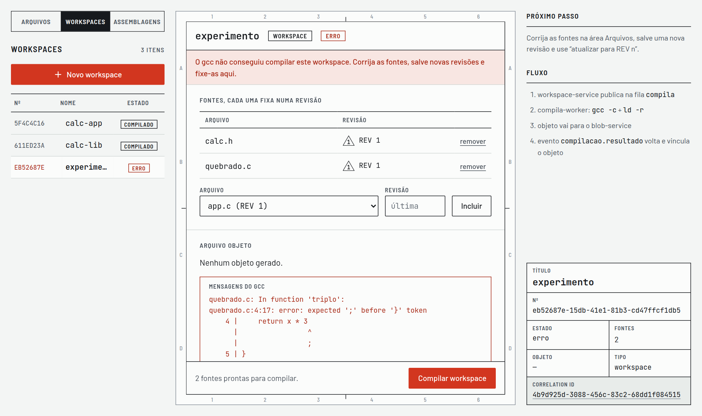
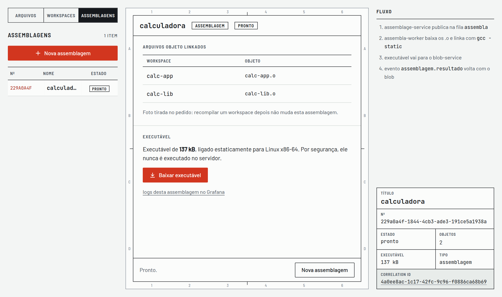

# Registro de Fontes

Uma toolchain C em microsserviços. Você cadastra **fontes** `.c`/`.h` com histórico de revisões, junta fontes em **workspaces** que compilam num arquivo objeto (`.o`) e junta objetos em **assemblagens** que linkam num executável. Compilar e linkar são assíncronos: o pedido vai para uma fila do RabbitMQ, um worker roda o gcc e o resultado volta por evento.

Construída para a disciplina *Arquitetura de Microsserviços e Escalabilidade* (Pós Unifor 2026.2).



| Quer… | Vá para |
|---|---|
| Subir o projeto | [Como rodar](#como-rodar) |
| Usar a aplicação | [Passo a passo](#passo-a-passo) |
| Entender a arquitetura | [Arquitetura](#arquitetura) e [`docs/arquitetura.md`](docs/arquitetura.md) |
| Ver as decisões | [`docs/ADR-001.md`](docs/ADR-001.md) … [`docs/ADR-012.md`](docs/ADR-012.md) |
| Ver SLOs e testes de carga | [`docs/slos.md`](docs/slos.md) e [`docs/resultados-carga.md`](docs/resultados-carga.md) |
| Apresentar | [Roteiro da demonstração](#roteiro-da-demonstração) |

## Membros do grupo

| Nome | GitHub |
|---|---|
| Williame Correia | @WilliameCorreia | 
| Arion Mathias  | @arionmath | 
| Jefferson Quesado  | @jeffque | 
| Janderson Siqueira  | @jandersonsiqueira | 

## Como rodar

### Pré-requisitos

| Item | Detalhe |
|---|---|
| Docker com Compose v2 | Docker Engine 24 ou mais novo (ou Docker Desktop). Confira com `docker compose version`. |
| Memória e disco | Os 20 containers usam cerca de 1,2 GB de RAM em repouso (reserve 2 GB) e as imagens ocupam cerca de 1,4 GB de disco. |
| Internet na primeira vez | Para baixar as imagens e instalar as dependências do Node e o gcc dos workers. Depois disso, roda offline. |
| Portas livres | 3000 a 3005 e 15672, todas em `127.0.0.1`. |

Para ver se alguma porta já está ocupada (no Linux):

```bash
ss -ltn | grep -E ':(300[0-5]|15672)\b'    # sem saída = tudo livre
```

Não é preciso instalar Node, Postgres, RabbitMQ nem gcc: tudo roda dentro dos containers.

### Subir

```bash
git clone <url-do-repositório> && cd trab-pos-2026-oct
docker compose up --build -d     # -d roda em segundo plano
docker compose ps                # espere todos ficarem "healthy" (alguns minutos na primeira vez)
```

Depois abra **http://localhost:3000**.

| O quê | Endereço |
|---|---|
| **Aplicação** | http://localhost:3000 |
| Logs centralizados (Grafana, dashboard "Logs") | http://localhost:3003 |
| Painel do RabbitMQ (usuário e senha `guest`) | http://localhost:15672 |
| API do blob-service (via load balancer) | http://localhost:3001 |
| API do source-service (via load balancer) | http://localhost:3002 |
| API do workspace-service | http://localhost:3004 |
| API do assemblage-service | http://localhost:3005 |

### Conferir que está tudo de pé

```bash
curl -s localhost:3002/health/ready    # source-service: banco e blob-service "ok"
curl -s localhost:3004/health/ready    # workspace-service: banco, rabbitmq, source e blob "ok"
docker compose logs -f bff             # acompanhar um serviço
```

### Parar

```bash
docker compose down        # para e remove os containers; os dados são apagados (não há volumes)
```

Para começar a apresentação com os bancos vazios, rode `docker compose down` e depois `docker compose up -d`.

### Problemas comuns

| Sintoma | Causa e solução |
|---|---|
| `Bind for 127.0.0.1:300X failed: port is already allocated` | Outro programa ou container usa a porta. Descubra com `docker ps --format '{{.Names}} {{.Ports}}'` ou `ss -ltnp`, pare-o e rode `docker compose up -d` de novo. |
| Algum serviço fica `unhealthy` ou `starting` | Na primeira vez o build demora. Veja o motivo com `docker compose logs <serviço>`. Se um container ficou pela metade, rode `docker compose down` e depois `docker compose up --build -d`. |
| A compilação fica "na fila" para sempre | O worker não está consumindo. Veja `docker compose logs compila-worker` e o painel do RabbitMQ (fila `compila`). |
| O executável baixado não roda | Ele é Linux x86-64. No macOS ou no Windows, rode dentro de um container: `docker run --rm -v "$PWD":/w -w /w alpine ./calculadora`. |

## Passo a passo

O exemplo monta uma calculadora com três arquivos: `calc.h` (declarações), `calc.c` (funções) e `app.c` (o `main`).

### 1. Arquivos: cadastre as fontes

Em **Arquivos → Novo arquivo**, crie `calc.h`, `calc.c` e `app.c`. Cada vez que você salva (botão ou **Ctrl+S**), nasce uma nova revisão (REV 1, REV 2…). As revisões antigas continuam lá e não mudam. À direita aparecem as revisões e os workspaces que usam o arquivo.

<details>
<summary>Conteúdo dos três arquivos</summary>

```c
/* calc.h */
#ifndef CALC_H
#define CALC_H
int dobro(int x);
int quadrado(int x);
#endif
```

```c
/* calc.c */
#include "calc.h"
int dobro(int x) { return x + x; }
int quadrado(int x) { return x * x; }
```

```c
/* app.c */
#include <stdio.h>
#include "calc.h"
int main(void) {
    printf("dobro(21) = %d, quadrado(7) = %d\n", dobro(21), quadrado(7));
    return 0;
}
```
</details>



### 2. Workspaces: fixe revisões e compile

Em **Workspaces → Novo workspace**, crie:

- `calc-lib` com `calc.c` e `calc.h`;
- `calc-app` com `app.c` e `calc.h`.

Cada fonte entra **numa revisão fixa**. Se você salvar uma REV nova depois, o workspace não muda até você atualizá-lo.

Clique em **Compilar workspace**. O estado vai de `rascunho` para `na fila` e então para `compilado`. A tela se atualiza sozinha quando o worker termina. O arquivo objeto pode ser baixado.



Se o gcc falhar, o estado vira `erro` e a tela mostra as mensagens do compilador. Corrija o arquivo, salve uma nova revisão, atualize a revisão no workspace e compile de novo.



### 3. Assemblagens: linke os objetos

Em **Assemblagens → Nova assemblagem**, dê o nome `calculadora`, marque `calc-lib` e `calc-app` (só aparecem workspaces compilados) e clique em **Criar assemblagem**. Quando o estado virar `pronto`, clique em **Baixar executável**.

A assemblagem guarda uma cópia dos objetos no momento do pedido. Recompilar um workspace depois não muda uma assemblagem já feita.



### 4. Rode o executável

```bash
chmod +x calculadora
./calculadora
# dobro(21) = 42, quadrado(7) = 49
```

O executável é linkado de forma estática e roda em qualquer Linux x86-64. Ele nunca é executado no servidor.

### 5. Siga uma requisição nos logs

Em qualquer workspace ou assemblagem, o link **logs desta compilação no Grafana** abre os logs filtrados pelo Correlation ID daquele pedido. As linhas mostram o caminho completo: bff → workspace-service → fila → compila-worker → source-service e blob-service → evento de volta.

## Arquitetura

```
navegador → bff ─┬→ source-lb (nginx) → source-service ×2 → postgres-sources
                 ├→ workspace-service → postgres-workspaces
                 └→ assemblage-service → postgres-assemblages
source-service e workers → blob-lb (nginx) → blob-service ×2 → postgres-blob

workspace-service  ── fila compila  ──→ compila-worker  ── evento compilacao.resultado ──→ workspace-service
assemblage-service ── fila assembla ──→ assembla-worker ── evento assemblagem.resultado ──→ assemblage-service

logs: todos os containers → alloy → loki → grafana
```

Cada serviço tem o próprio banco Postgres e só acessa os dados dos outros pela API. A seção 3 de [`docs/arquitetura.md`](docs/arquitetura.md) tem os diagramas completos.

| Pasta | Container | Responsabilidade |
|---|---|---|
| [`bff/`](bff) | `bff` | Interface web (Express + Liquid + HTMX) |
| [`source-service/`](source-service) | `source-service` ×2 | Fontes e revisões |
| [`workspace-service/`](workspace-service) | `workspace-service` | Workspaces: fontes em revisões fixas → arquivo objeto |
| [`assemblage-service/`](assemblage-service) | `assemblage-service` | Assemblagens: objetos → executável |
| [`blob-service/`](blob-service) | `blob-service` ×2 | Armazenamento de bytes opacos por UUID |
| [`build-worker/`](build-worker) | `compila-worker`, `assembla-worker` | Consomem as filas, rodam gcc/ld e publicam o evento de resultado |
| [`load-balancer/`](load-balancer) | `source-lb`, `blob-lb` | nginx com round-robin entre réplicas |
| [`postgres-schemas/`](postgres-schemas) | `postgres-*` | Criação do schema e das tabelas de cada banco |
| [`observability/`](observability) | `alloy`, `loki`, `grafana` | Coleta e consulta de logs |
| [`testes/`](testes) | (k6) | Testes de carga e do SLO |

<details>
<summary><strong>Endpoints de cada serviço</strong></summary>

Todos os serviços HTTP têm `GET /health/live` (processo de pé) e `GET /health/ready` (dependências, com latência de cada uma).

#### source-service (`localhost:3002`)

| Método e rota | Descrição |
|---|---|
| `GET /source?page=N` | Lista arquivos (50 por página) |
| `POST /source` `{filename, content}` | Cria o arquivo na REV 1 → `201 {id, version}` |
| `GET /source/:id` | Nome e lista de revisões |
| `POST /source/:id/versions` `{content}` | Cria a REV n+1 → `201 {id, version}` |
| `GET /content/:nome/:rev` | Conteúdo de uma revisão |

#### workspace-service (`localhost:3004`)

| Método e rota | Descrição |
|---|---|
| `GET /workspaces` (`?source_id=` filtra quem usa uma fonte) | Lista workspaces |
| `POST /workspaces` `{name}` | Cria em `rascunho` → `201` |
| `GET /workspaces/:id` | Estado, fontes fixadas, log do gcc |
| `POST /workspaces/:id/files` `{source_id, version?}` | Inclui (ou troca a revisão de) um `.c`/`.h`; sem `version` = última |
| `DELETE /workspaces/:id/files/:sourceId` | Remove uma fonte |
| `POST /workspaces/:id/compilar` | Publica na fila `compila` → `202` |
| `GET /workspaces/:id/objeto` | Arquivo objeto (`.o`) gerado |

#### assemblage-service (`localhost:3005`)

| Método e rota | Descrição |
|---|---|
| `GET /assemblages` | Lista assemblagens |
| `POST /assemblages` `{name, workspace_ids}` | Linka os objetos de workspaces compilados → fila `assembla` → `202` |
| `GET /assemblages/:id` | Estado, objetos usados, log do linker |
| `GET /assemblages/:id/executavel` | Executável gerado |

#### blob-service (`localhost:3001`)

| Método e rota | Descrição |
|---|---|
| `POST /blob` (corpo `application/octet-stream`) | Guarda bytes → `201 {id}` |
| `GET /blob?page=N` | Lista blobs |
| `GET /blob/:id` | Blob em JSON (com md5) |
| `GET /content/:id` | Bytes crus |

#### bff (`localhost:3000`)

| Rota | Tela ou ação |
|---|---|
| `GET /`, `/novo`, `/source/:id?rev=N` | Arquivos: registro, criação e edição (Ctrl+S salva nova revisão) |
| `GET /workspaces`, `/workspaces/novo`, `/workspaces/:id` | Workspaces: montar, fixar revisões e compilar |
| `GET /assemblagens`, `/assemblagens/novo`, `/assemblagens/:id` | Assemblagens: escolher objetos, linkar e baixar o executável |

</details>

<details>
<summary><strong>O mesmo fluxo pela API, com curl</strong></summary>

Precisa de `curl` e `jq`.

```bash
J='Content-Type: application/json'
# 1. fontes
H=$(curl -s -X POST localhost:3002/source -H "$J" \
  -d '{"filename":"calc.h","content":"int dobro(int x);\n"}' | jq -r .id)
C=$(curl -s -X POST localhost:3002/source -H "$J" \
  -d '{"filename":"calc.c","content":"#include \"calc.h\"\nint dobro(int x) { return 2 * x; }\n"}' | jq -r .id)
M=$(curl -s -X POST localhost:3002/source -H "$J" \
  -d '{"filename":"app.c","content":"#include <stdio.h>\n#include \"calc.h\"\nint main(void) { printf(\"%d\\n\", dobro(21)); }\n"}' | jq -r .id)

# 2. workspaces: inclui as fontes e compila
ws() {
  local W=$(curl -s -X POST localhost:3004/workspaces -H "$J" -d "{\"name\":\"$1\"}" | jq -r .id)
  for f in "${@:2}"; do curl -s -o /dev/null -X POST localhost:3004/workspaces/$W/files -H "$J" -d "{\"source_id\":\"$f\"}"; done
  curl -s -o /dev/null -X POST localhost:3004/workspaces/$W/compilar
  echo $W
}
LIB=$(ws calc-lib $C $H); APP=$(ws calc-app $M $H)
sleep 3; curl -s localhost:3004/workspaces/$LIB | jq .status     # "compilado"

# 3. assemblagem e download
A=$(curl -s -X POST localhost:3005/assemblages -H "$J" \
  -d "{\"name\":\"calculadora\",\"workspace_ids\":[\"$LIB\",\"$APP\"]}" | jq -r .id)
sleep 3; curl -s localhost:3005/assemblages/$A | jq .status      # "pronto"
curl -s -o calculadora localhost:3005/assemblages/$A/executavel && chmod +x calculadora && ./calculadora   # 42
```

</details>

## Roteiro da demonstração

1. `docker compose up --build -d` e `docker compose ps` (todos `healthy`).
2. **Arquivos**: criar `calc.h`, `calc.c` e `app.c`; salvar uma REV 2 de `calc.c` com Ctrl+S.
3. **Workspaces**: `calc-lib` com `calc.c` + `calc.h`; `calc-app` com `app.c` + `calc.h`. Compilar os dois: "na fila" vira "compilado" quando o evento volta. Mostrar um workspace com erro do gcc.
4. **Assemblagens**: `calculadora` com os dois objetos. Baixar o executável e rodar no terminal.
5. Clicar em **logs** numa compilação: o Grafana mostra o mesmo Correlation ID em bff, workspace-service, compila-worker, source-lb, source-service, blob-lb e blob-service, até o evento voltar.
6. Balanceamento e falha:
   ```bash
   for i in 1 2 3 4; do curl -sI localhost:3002/source | grep X-Upstream; done   # alterna entre réplicas
   docker stop trab-pos-2026-oct-source-service-1                              # a aplicação continua respondendo
   docker compose restart postgres-sources                                      # o serviço sobrevive ao reinício do banco
   curl -s localhost:3002/health/ready                                          # estado das dependências
   ```
7. Escala: `docker compose up -d --scale compila-worker=3` e o painel do RabbitMQ (filas de trabalho e de eventos).

## Testes de carga

Os testes usam o k6 pela imagem Docker; não é preciso instalar nada.

```bash
# misto (leitura, página e compilação), cerca de 70 s
docker run --rm -i --network host grafana/k6 run - < testes/carga.js

# protocolo do SLO de metadados do grupo, cerca de 6 min; salva o JSON em testes/resultados/
docker run --rm -i --network host --user "$(id -u):$(id -g)" -v "$PWD/testes/resultados:/out" \
  grafana/k6 run - < testes/slo-source.js
```

`--network host` só funciona no Linux. No Docker Desktop, troque por `-e SOURCE_URL=http://host.docker.internal:3002` no teste do SLO.

Os resultados medidos estão em [`docs/resultados-carga.md`](docs/resultados-carga.md) e [`docs/slos.md`](docs/slos.md).

## Desenvolvimento

Cada serviço Node roda com `npm install` e `npm run dev` (nodemon + tsc) e lê a configuração de variáveis de ambiente. O blob-service e o source-service têm um `.env.example`. No Docker, as URLs entre serviços vêm de [`docker.env`](docker.env): `BLOB_MODULE`, `SOURCE_MODULE`, `WORKSPACE_MODULE`, `ASSEMBLAGE_MODULE` e `RABBIT_URL`.

Para mudar só um serviço com a stack de pé: `docker compose up --build -d <serviço>`.
