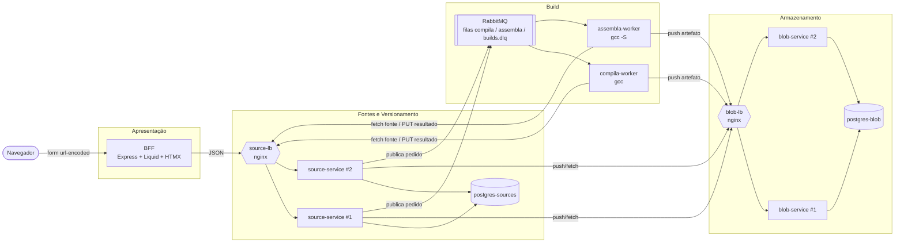
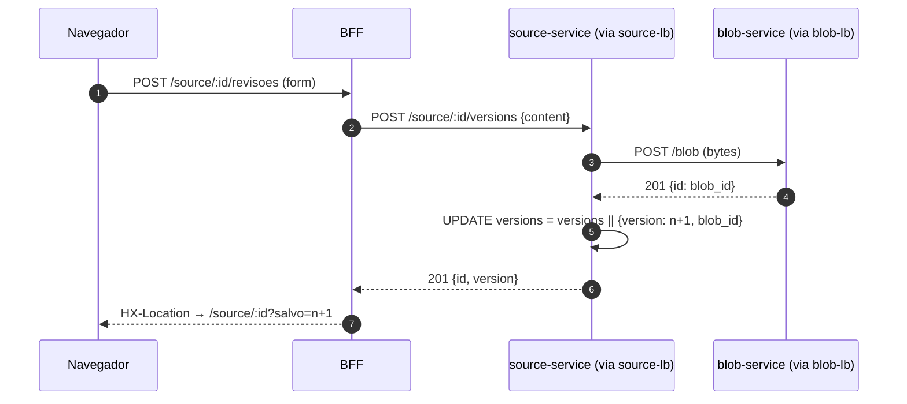
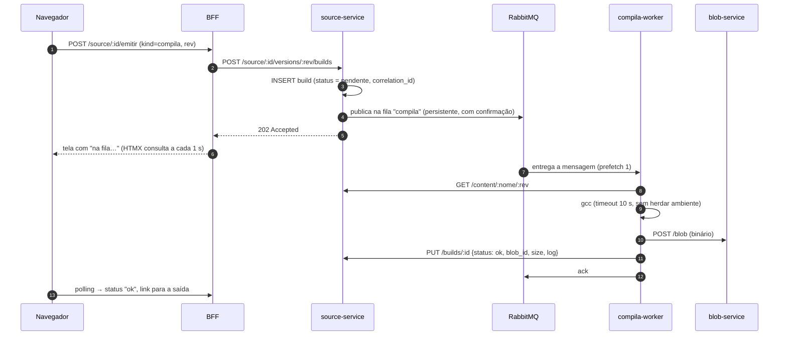

# Documento de Arquitetura: Registro de Fontes

> Projeto integrador da disciplina **Arquitetura de Microsserviços e Escalabilidade** (Pós Unifor 2026.2).
> Decisões detalhadas em [ADRs](#11-decisões-arquiteturais-adrs). Como rodar: [README](../README.md).

## 1. Contexto e problema

**O que o sistema faz.** É uma plataforma web para guardar arquivos de código C com **histórico de versões** e, a partir de qualquer versão, **compilar** (log do gcc + binário) ou **gerar o assembly**. Pense num "Git simplificado + Compiler Explorer" acessado pelo navegador.

**Usuários.** Desenvolvedores e estudantes que escrevem programas pequenos em C e querem guardar revisões e ver o resultado da compilação sem instalar toolchain local.

**Volume estimado (hipótese de projeto).** Turmas e pequenos times: ~200 usuários ativos/dia, ~5 mil leituras de arquivo/dia, ~1 mil compilações/dia, com picos em horário de aula (até ~20 req/s de leitura e ~5 builds/s). Arquivos-fonte pequenos (até 10 MB por blob).

**Problema que a arquitetura resolve.** As cargas são muito diferentes entre si:

| Carga | Perfil | Consequência |
|---|---|---|
| Ler/salvar metadados e versões | leve, frequente, latência importa | precisa responder rápido e escalar horizontalmente |
| Guardar/servir conteúdo (bytes) | volume de dados, sem regra de negócio | componente genérico, reaproveitável (fonte, binário, assembly) |
| Compilar/assemblar | lento, CPU intensiva, código não confiável | não pode travar a requisição nem derrubar o resto do sistema |

Num monolito, um pico de compilações (CPU) degradaria a leitura de arquivos, e um bug no compilador afetaria todo o sistema. Separar as cargas permite **escalar e isolar cada uma de forma independente**.

### Framework de decisão (as 3 perguntas, Aula 1)

| Pergunta | Resposta no nosso contexto |
|---|---|
| Múltiplos times com fricção no mesmo codebase? | Simulamos três frentes independentes (armazenamento, fontes/versões, build) com contratos HTTP/fila estáveis entre elas. Num time único e pequeno, a resposta honesta seria **não**: ver riscos na seção 10. |
| O domínio é compreendido o suficiente para fronteiras estáveis? | **Sim.** "Bytes opacos", "nomes e versões" e "transformar fonte em artefato" são responsabilidades com pouca sobreposição e interfaces pequenas. |
| Temos maturidade operacional? | **Parcial.** Temos ambiente reprodutível (Docker Compose), health checks, logs centralizados com Correlation ID e balanceamento com failover. Faltam CI/CD e métricas (Prometheus): ver seção 10. |

## 2. Bounded Contexts

| Contexto | Responsabilidade | Dados próprios | Tipo | Serviço |
|---|---|---|---|---|
| **Armazenamento** | Guardar e devolver bytes por UUID. Não conhece "arquivo", "versão" nem "build". | `blob.storage` (conteúdo + md5) | Generic | `blob-service` |
| **Fontes e Versionamento** | Nomes de arquivo, lista de revisões, pedidos de build e seus status. Esconde o blob dos consumidores. | `source.source`, `source.build` | **Core** | `source-service` |
| **Build** | Transformar uma revisão em binário ou assembly, isolando código não confiável. | nenhum (stateless; resultado vai para o Armazenamento) | Core | `compila-worker`, `assembla-worker` |
| **Apresentação** | Interface web; orquestra chamadas para a tela. | nenhum | Supporting | `bff` |

**Linguagem ubíqua:** *arquivo* (source), *revisão/REV* (versão numerada a partir de 1, imutável), *blob* (bytes opacos), *emissão/build* (pedido de compilação ou assembly), *compila* / *assembla* (tipos de build e nomes das filas).

## 3. Visão geral

Rascunho original do grupo: [`img/arquitetura-alvo-rascunho.png`](img/arquitetura-alvo-rascunho.png). Arquitetura implementada:

Observabilidade (fora do caminho da requisição): todos os containers escrevem log JSON no stdout → **Alloy** coleta → **Loki** guarda → **Grafana** consulta (ver seção 8).

### Serviços

| Serviço | Porta no host | Réplicas | Função |
|---|---|---|---|
| `bff` | 3000 | 1 | Interface web, SSR com HTMX |
| `source-lb` → `source-service` | 3002 | 2 | Metadados, versões, pedidos de build |
| `blob-lb` → `blob-service` | 3001 | 2 | Armazenamento de bytes |
| `compila-worker` / `assembla-worker` | (sem porta) | 1 + 1, escaláveis | Consomem as filas e rodam o gcc |
| `rabbitmq` | 15672 (painel) | 1 | Filas de build |
| `postgres-sources` / `postgres-blob` | (não expostos) | 1 + 1 | Um banco por serviço |
| `grafana` (+ `loki`, `alloy`) | 3003 | 1 | Logs centralizados |

## 4. Fluxos principais

### Salvar uma nova revisão (síncrono)

O número da revisão é calculado **dentro do UPDATE** (`jsonb_array_length + 1`): a trava de linha do Postgres impede que dois salvamentos simultâneos gerem o mesmo número.

### Compilar (assíncrono)

Se o worker falhar inesperadamente, ele registra `erro` no build e manda a mensagem para a **DLQ** (`builds.dlq`) com `nack` sem reenvio, sem loop infinito de reprocessamento.

## 5. Comunicação entre serviços

| De → Para | Estilo | Por quê |
|---|---|---|
| Navegador → BFF | HTTP, formulários + HTMX | progressivo, sem SPA ([ADR-002](ADR-002.md)) |
| BFF → source, source → blob | REST síncrono, JSON / octet-stream | operações curtas que o usuário espera ver concluídas ([ADR-003](ADR-003.md)) |
| source → workers | **assíncrono**, RabbitMQ, padrão Queue | compilação é lenta e pesada ([ADR-004](ADR-004.md)) |
| workers → source / blob | REST síncrono | buscar fonte, gravar artefato e devolver resultado |

Todas as chamadas internas passam pelos load balancers (`source-lb`, `blob-lb`), nunca por uma réplica específica.

## 6. Dados

- **Um banco por serviço** ([ADR-006](ADR-006.md)): `postgres-sources` e `postgres-blob`. Nenhum serviço lê o banco do outro; o acesso é só pela API.
- O blob é **opaco**: o `blob_id` nunca sai do source-service para o BFF.
- Versões são **imutáveis**: salvar sempre cria REV n+1; nada é sobrescrito.
- Bancos sem volume persistente (ambiente de disciplina): `docker compose down` zera os dados. Para persistir, há linhas comentadas no `docker-compose.yml`.

## 7. Requisitos não funcionais e SLOs

SLIs medidos do ponto de vista do usuário, em cima do load balancer ou do BFF:

| SLI | SLO | Justificativa |
|---|---|---|
| Latência de `GET /content/:nome/:rev` (leitura de conteúdo, passa por source + blob) | **p95 < 100 ms, p99 < 250 ms** | é a operação mais frequente; passa por 2 serviços e 2 LBs |
| Latência de `GET /source/:id` no BFF (página do arquivo) | **p95 < 200 ms, p99 < 500 ms** | tela interativa |
| Taxa de erro HTTP (5xx) nas leituras | **< 1 %** | |
| Tempo de build (pedido → resultado), medido por `finished_at - created_at` | **95 % em < 5 s** | assíncrono; o usuário vê "na fila…" |
| Disponibilidade mensal da leitura | **99,5 %** | ambiente acadêmico, sem plantão |

**Medição:** teste de carga com k6 em [`../testes/carga.js`](../testes/carga.js); resultados e conclusão sobre aderência aos SLOs em [`resultados-carga.md`](resultados-carga.md).

### Disponibilidade composta

Uma leitura de conteúdo atravessa em série: `source-lb → source-service → postgres-sources → blob-lb → blob-service → postgres-blob`. Supondo 99,9 % por componente:

- **Sem réplicas:** 0,999⁶ ≈ **99,4 %**.
- **Com 2 réplicas** de source e blob (falham de forma independente): cada par vira 1 − 0,001² ≈ 99,9999 %, e o total sobe para ≈ **99,6 %**. O que sobra de indisponibilidade está nos **bancos e nos LBs**, que hoje são instâncias únicas (ver seção 10).

Teste prático de failover: com uma réplica de source **e** uma de blob derrubadas (`docker stop`), 20 de 20 leituras responderam 200. Ao religar, as réplicas voltaram a receber tráfego sem reiniciar o nginx (o LB reconsulta o DNS do Docker a cada 5 s).

## 8. Observabilidade ([ADR-009](ADR-009.md))

- **Logs estruturados:** todos os serviços (e os dois nginx) escrevem uma linha JSON por evento com `time`, `level`, `service`, `instance` (réplica), `msg`, `correlation_id` e campos do evento (`method`, `path`, `status`, `duration_ms`, `build_id`...). Consultas ao banco ficam em `debug`.
- **Correlation ID:** criado no BFF (ou aceito do header `X-Correlation-ID`), devolvido na resposta, propagado por HTTP para source e blob e **dentro da mensagem do RabbitMQ** até o worker. Fica gravado em cada build.
- **Logs centralizados:** Alloy → Loki → Grafana (`http://localhost:3003`, dashboard "Logs"): filtro por Correlation ID e por serviço, volume de logs e erros por serviço. Na interface, o link **logs** de cada build e o **Correlation ID** no carimbo abrem o Grafana já filtrado.
- **Health checks:** `/health/live` (o processo está de pé) e `/health/ready` (dependências), com latência de cada checagem:
  - source-service: banco é **crítico** (503); blob e RabbitMQ são **não críticos** (200 `degraded`: a leitura de metadados continua funcionando).
  - blob-service: banco (crítico). BFF: source (crítico). Workers: conexão com o RabbitMQ.
  - O `docker-compose.yml` usa esses endpoints; os LBs só sobem quando as réplicas estão `healthy`.
- **Exemplo real:** um clique em "Assemblar" gerou 16 linhas de log em 7 componentes (bff, source-lb, source-service ×2 réplicas, assembla-worker, blob-lb, blob-service), todas com o mesmo ID. Foi assim que encontramos um bug no `PUT /builds` (500 em todo build) logo no primeiro teste.
- **Alertas (proposta):** alerta quando a taxa de `level=error` passar de 1 % das linhas em 5 min, ou quando p99 de leitura passar de 250 ms (este depende das métricas, ver seção 10).

## 9. Segurança

| Ameaça / requisito | O que fazemos |
|---|---|
| **Código não confiável no build** ([ADR-008](ADR-008.md)) | o programa **nunca é executado**; gcc com timeout de 10 s (SIGKILL), sem herdar variáveis de ambiente, em diretório temporário descartável; container com `mem_limit` 512 MB, 1 CPU, `pids_limit` 128 e `/tmp` em tmpfs; nome do arquivo sanitizado (evita `../` e nomes que o gcc leria como opção, como `-fplugin=...`) |
| Injeção de SQL | consultas sempre parametrizadas (`$1, $2...`) |
| XSS | templates Liquid com escape automático (`outputEscape: "escape"`) |
| Validação de entrada | UUIDs validados por regex, `kind` restrito a `compila`/`assembla`, nome de arquivo sem barras, Correlation ID externo aceito só se `[\w.-]{1,64}` |
| Limite de payload | 10 MB no nginx (`client_max_body_size`) e nos serviços |
| Exposição de dados | bancos não publicados no host; blob opaco para o BFF |
| Falhas visíveis | erros não tratados viram log JSON sem stack para o cliente |

**Lacunas conhecidas (OWASP API Top 10) e plano:**

| Lacuna | Risco | Plano |
|---|---|---|
| Sem autenticação/autorização | API1/API2: qualquer um lê e cria arquivos | OAuth 2.0 / OIDC no BFF, JWT propagado para os serviços, `owner_id` em `source` |
| Sem rate limiting | API4: abuso dos builds (CPU) | `limit_req` no nginx + limite de builds pendentes por usuário |
| Tráfego interno em HTTP puro | interceptação dentro da rede | TLS no LB de borda e mTLS entre serviços (ou service mesh) |
| Segredos em `docker.env` em texto | vazamento pelo repositório | Docker secrets / Vault; senhas diferentes por banco |
| Grafana anônimo como admin, Alloy com `docker.sock` (somente leitura) | aceitável só localmente | login no Grafana; coletor via driver de log em vez do socket |
| Worker ainda tem rede | código compilado não roda, mas o gcc acessa a rede do compose | rede dedicada só com source-lb/blob-lb, ou sandbox (gVisor/nsjail) |

## 10. Deploy, escala e limitações

**Escala horizontal** ([ADR-007](ADR-007.md)): serviços HTTP são stateless; `docker compose up -d --scale source-service=4 --scale compila-worker=3` adiciona instâncias sem tocar em configuração. Com 2 workers, o RabbitMQ dividiu 8 builds em 5/3, sem nenhum erro.

**Estratégia de deploy proposta:**
- **Rolling update** para `source-service`, `blob-service` e workers: subir réplica nova, esperar `/health/ready`, retirar a antiga. O LB já ignora réplicas fora do ar.
- **Canary** para o BFF quando houver mudança de interface: uma fração do tráfego para a versão nova (peso no nginx), observando a taxa de erro no Grafana.
- Mudanças de banco sempre **aditivas** (expand/contract), para que versões antiga e nova convivam durante o rolling update.

**Evolução dos dados (Database Decomposition):** o projeto começou na **Fase 2** (um Postgres, schema por serviço; e as tabelas estavam caindo no `public` por engano), e evoluiu para a **Fase 3** (um banco por serviço). Ver [ADR-005](ADR-005.md) → [ADR-006](ADR-006.md).

**Limitações conhecidas e próximos passos:**
1. Pontos únicos de falha: os LBs, os bancos e o RabbitMQ têm uma instância cada (próximo passo: réplica de leitura do Postgres, cluster RabbitMQ com quorum queues).
2. Sem métricas numéricas (Prometheus): hoje os SLOs são verificados por teste de carga, não continuamente.
3. Sem autenticação e sem CI/CD (seção 9).
4. Polling de 1 s para status de build: simples, mas gera tráfego; alternativa é SSE.
5. Blobs no Postgres (`BYTEA`) não escalam para arquivos grandes ([ADR-010](ADR-010.md)).

## 11. Decisões arquiteturais (ADRs)

| ADR | Decisão | Status |
|---|---|---|
| [ADR-001](ADR-001.md) | Separar armazenamento de bytes (blob) de metadados e versões (source) | Accepted |
| [ADR-002](ADR-002.md) | BFF com renderização no servidor (Express + Liquid + HTMX) | Accepted |
| [ADR-003](ADR-003.md) | REST síncrono entre BFF, source e blob | Accepted |
| [ADR-004](ADR-004.md) | Compilação assíncrona via RabbitMQ, com um worker por fila | Accepted |
| [ADR-005](ADR-005.md) | Um Postgres com schema por serviço | Superseded by ADR-006 |
| [ADR-006](ADR-006.md) | Um banco Postgres por serviço | Accepted |
| [ADR-007](ADR-007.md) | Réplicas atrás de load balancer nginx | Accepted |
| [ADR-008](ADR-008.md) | Isolamento dos workers que compilam código de usuário | Accepted |
| [ADR-009](ADR-009.md) | Logs JSON com Correlation ID centralizados em Loki/Grafana | Accepted |
| [ADR-010](ADR-010.md) | Conteúdo em `BYTEA` no Postgres e versões em array JSONB | Accepted |
