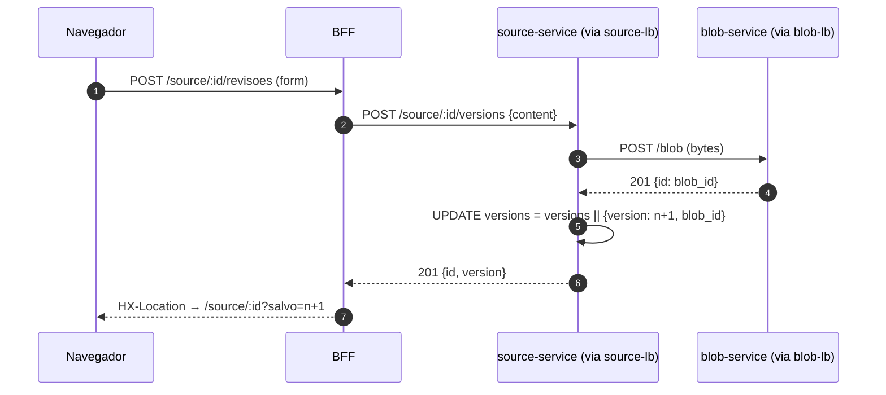
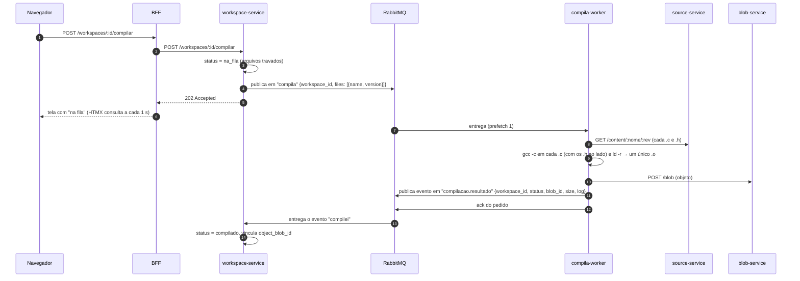

# Documento de Arquitetura: Registro de Fontes

> Projeto integrador da disciplina **Arquitetura de Microsserviços e Escalabilidade** (Pós Unifor 2026.2).
> Decisões detalhadas em [ADRs](#11-decisões-arquiteturais-adrs). Como rodar: [README](../README.md).

## 1. Contexto e problema

**O que o sistema faz.** Uma plataforma web para trabalhar com código C em três etapas, como numa toolchain:

1. **Fontes**: arquivos `.c` e `.h` guardados com histórico de revisões imutáveis.
2. **Workspaces**: um conjunto de fontes, cada uma fixa numa revisão, que é compilado num **arquivo objeto (`.o`)**.
3. **Assemblagens**: um conjunto arbitrário de arquivos objeto (de vários workspaces) **linkado num executável**.

Tudo o que é conteúdo (fontes, objetos, executáveis) fica num serviço central de blobs; cada etapa tem seu próprio serviço com os metadados "humanos" (nomes, revisões, estados). Esta é a proposta original do criador do projeto, implementada como está descrita (ver [ADR-011](ADR-011.md)).

**Usuários.** Desenvolvedores e estudantes que escrevem programas pequenos em C e querem versionar fontes, montar bibliotecas reaproveitáveis (workspaces) e gerar executáveis sem instalar toolchain local.

**Volume estimado (hipótese de projeto).** Turmas e pequenos times: ~200 usuários ativos/dia, ~5 mil leituras de arquivo/dia, ~1 mil compilações/dia, com picos em horário de aula (até ~20 req/s de leitura e ~5 compilações/s). Arquivos pequenos (até 10 MB por blob).

**Problema que a arquitetura resolve.** As cargas são muito diferentes entre si:

| Carga | Perfil | Consequência |
|---|---|---|
| Ler/salvar fontes e revisões | leve, frequente, latência importa | precisa responder rápido e escalar horizontalmente |
| Guardar/servir conteúdo (bytes) | volume de dados, sem regra de negócio | componente genérico, reaproveitado por todos (fonte, `.o`, executável) |
| Compilar e linkar | lento, CPU intensiva, código não confiável | não pode travar a requisição nem derrubar o resto do sistema |

Num monolito, um pico de compilações (CPU) degradaria a leitura de arquivos, e um bug no compilador afetaria todo o sistema. Separar as cargas permite **escalar e isolar cada uma de forma independente**.

### Framework de decisão (as 3 perguntas, Aula 1)

| Pergunta | Resposta no nosso contexto |
|---|---|
| Múltiplos times com fricção no mesmo codebase? | Simulamos quatro frentes independentes (armazenamento, fontes, workspaces, assemblagens) com contratos HTTP e de fila estáveis. Num time único e pequeno, a resposta honesta seria **não**: ver riscos na seção 10. |
| O domínio é compreendido o suficiente para fronteiras estáveis? | **Sim.** As etapas de uma toolchain C (fonte → objeto → executável) são clássicas e têm fronteiras naturais: cada uma consome o artefato da anterior. |
| Temos maturidade operacional? | **Parcial.** Temos ambiente reprodutível (Docker Compose), health checks, logs centralizados com Correlation ID e balanceamento com failover. Faltam CI/CD e métricas (Prometheus): ver seção 10. |

## 2. Bounded Contexts

| Contexto | Responsabilidade | Dados próprios | Tipo | Serviço |
|---|---|---|---|---|
| **Fontes** | Nomes de arquivo e revisões imutáveis. Esconde o blob dos consumidores. | `source.source` | **Core** | `source-service` (2 réplicas) |
| **Workspaces** | Conjunto de fontes em revisões fixas; ciclo rascunho → na fila → compilado/erro; vínculo com o objeto gerado. | `workspace.workspace`, `workspace.workspace_file` | **Core** | `workspace-service` + `compila-worker` |
| **Assemblagens** | Conjunto de objetos de workspaces compilados; foto dos objetos usados; vínculo com o executável. | `assemblage.assemblage`, `assemblage.assemblage_object` | **Core** | `assemblage-service` + `assembla-worker` |
| **Armazenamento** | Guardar e devolver bytes por UUID. Não sabe o que é fonte, objeto ou executável. | `blob.storage` | Generic | `blob-service` (2 réplicas) |
| **Apresentação** | Interface web; orquestra chamadas para a tela. | nenhum | Supporting | `bff` |

**Linguagem ubíqua:** *fonte/arquivo* (`.c` ou `.h` registrado), *revisão/REV* (versão numerada a partir de 1, imutável), *workspace* (fontes em revisões fixas que viram um objeto), *arquivo objeto* (`.o`), *assemblagem* (objetos linkados num executável), *blob* (bytes opacos), *compila* / *assembla* (filas de trabalho), *compilei* / *assemblei* (eventos de resultado).

## 3. Visão geral

Rascunho original do grupo: [`img/arquitetura-alvo-rascunho.png`](img/arquitetura-alvo-rascunho.png). Arquitetura implementada:

```mermaid
flowchart LR
    browser([Navegador])
    bff[BFF<br/>Express + Liquid + HTMX]
    subgraph fontes[Fontes]
        slb{{source-lb · nginx}}
        src[source-service ×2]
        pgs[(postgres-sources)]
    end
    subgraph ws[Workspaces]
        wss[workspace-service]
        pgw[(postgres-workspaces)]
        cw[compila-worker<br/>gcc -c · ld -r]
    end
    subgraph asm[Assemblagens]
        ass[assemblage-service]
        pga[(postgres-assemblages)]
        aw[assembla-worker<br/>gcc -static]
    end
    subgraph armazenamento[Armazenamento]
        blb{{blob-lb · nginx}}
        blob[blob-service ×2]
        pgb[(postgres-blob)]
    end
    mq[[RabbitMQ<br/>compila · assembla<br/>compilacao.resultado · assemblagem.resultado<br/>builds.dlq]]

    browser -- form url-encoded --> bff
    bff -- JSON --> slb & wss & ass
    slb --> src --> pgs
    src -- conteúdo --> blb
    wss --> pgw
    wss -- valida fontes --> slb
    ass --> pga
    ass -- consulta objetos --> wss
    wss -. publica compila .-> mq
    mq -. compila .-> cw
    cw -. evento compilei .-> mq
    mq -. compilacao.resultado .-> wss
    ass -. publica assembla .-> mq
    mq -. assembla .-> aw
    aw -. evento assemblei .-> mq
    mq -. assemblagem.resultado .-> ass
    cw -- busca fontes --> slb
    cw & aw -- grava/lê artefatos --> blb
    blb --> blob --> pgb
```

Linhas tracejadas = assíncrono (fila). Observabilidade (fora do caminho da requisição): todos os containers escrevem log JSON no stdout → **Alloy** coleta → **Loki** guarda → **Grafana** consulta (ver seção 8).

### Serviços

| Serviço | Porta no host | Réplicas | Função |
|---|---|---|---|
| `bff` | 3000 | 1 | Interface web, SSR com HTMX |
| `source-lb` → `source-service` | 3002 | 2 | Fontes e revisões |
| `blob-lb` → `blob-service` | 3001 | 2 | Armazenamento de bytes |
| `workspace-service` | 3004 | 1 | Workspaces; publica `compila`, consome `compilacao.resultado` |
| `assemblage-service` | 3005 | 1 | Assemblagens; publica `assembla`, consome `assemblagem.resultado` |
| `compila-worker` / `assembla-worker` | (sem porta) | 1 + 1, escaláveis | Consomem as filas de trabalho e rodam o gcc |
| `rabbitmq` | 15672 (painel) | 1 | Filas de trabalho, de eventos e DLQ |
| `postgres-sources`, `-workspaces`, `-assemblages`, `-blob` | (não expostos) | 1 cada | Um banco por serviço |
| `grafana` (+ `loki`, `alloy`) | 3003 | 1 | Logs centralizados |

## 4. Fluxos principais

### Salvar uma nova revisão (síncrono)



O número da revisão é calculado **dentro do UPDATE** (`jsonb_array_length + 1`): a trava de linha do Postgres impede que dois salvamentos simultâneos gerem o mesmo número.

### Compilar um workspace (assíncrono, resultado por evento)



### Assemblar (assíncrono, resultado por evento)

O `assemblage-service` recebe `{name, workspace_ids}`, pergunta ao `workspace-service` o objeto de cada workspace (só aceita `compilado`), guarda uma **foto** dos objetos usados (recompilar um workspace depois não altera a assemblagem) e publica em `assembla`. O `assembla-worker` baixa os `.o` do blob-service, linka com `gcc -static`, grava o executável no blob e publica `assemblagem.resultado`; o `assemblage-service` consome o evento e guarda o `blob_id` do executável.

Se um worker falhar inesperadamente, ele publica um evento de `erro` com o motivo e manda a mensagem de trabalho para a **DLQ** (`builds.dlq`) com `nack` sem reenvio, sem loop infinito de reprocessamento.

## 5. Comunicação entre serviços

| De → Para | Estilo | Por quê |
|---|---|---|
| Navegador → BFF | HTTP, formulários + HTMX | progressivo, sem SPA ([ADR-002](ADR-002.md)) |
| BFF → source / workspace / assemblage; source → blob | REST síncrono, JSON / octet-stream | operações curtas que o usuário espera ver concluídas ([ADR-003](ADR-003.md)) |
| workspace → source; assemblage → workspace | REST síncrono | validar fontes e revisões; obter os objetos compilados |
| workspace → `compila`; assemblage → `assembla` | **assíncrono**, RabbitMQ, padrão Queue | compilar e linkar são lentos e pesados ([ADR-011](ADR-011.md)) |
| workers → `compilacao.resultado` / `assemblagem.resultado` | **evento** na fila | o worker não conhece o dono do pedido; quem pediu consome o resultado |
| workers → source-lb / blob-lb | REST síncrono | buscar fontes e objetos, gravar artefatos |

Todas as chamadas a source e blob passam pelos load balancers, nunca por uma réplica específica.

## 6. Dados

- **Um banco por serviço** ([ADR-006](ADR-006.md)): `postgres-sources`, `postgres-workspaces`, `postgres-assemblages` e `postgres-blob`. Nenhum serviço lê o banco do outro; o acesso é só pela API ou pela fila.
- O blob é **opaco** para a interface: o BFF nunca recebe `blob_id`; downloads de objeto e executável passam pelo serviço dono (`/workspaces/:id/objeto`, `/assemblages/:id/executavel`).
- Revisões são **imutáveis**: salvar sempre cria REV n+1. Um workspace fixa revisões; alterar os arquivos o volta para `rascunho` e descarta o objeto antigo.
- Uma assemblagem guarda a **foto** dos objetos (blob ids) no momento do pedido.
- Bancos sem volume persistente (ambiente de disciplina): `docker compose down` zera os dados.

## 7. Requisitos não funcionais e SLOs

SLIs medidos do ponto de vista do usuário, em cima do load balancer, do BFF ou do serviço dono:

| SLI | SLO | Justificativa |
|---|---|---|
| Latência de `GET /content/:nome/:rev` (leitura de conteúdo, passa por source + blob) | **p95 < 100 ms, p99 < 250 ms** | é a operação mais frequente; passa por 2 serviços e 2 LBs |
| Latência de `GET /source/:id` no BFF (página do arquivo) | **p95 < 200 ms, p99 < 500 ms** | tela interativa; consulta source, blob e workspace |
| Taxa de erro HTTP (5xx) nas leituras | **< 1 %** | |
| Compilação de workspace (pedido → objeto vinculado pelo evento), `compiled_at - queued_at` | **95 % em < 5 s** | assíncrono; o usuário vê "na fila" |
| Disponibilidade mensal da leitura | **99,5 %** | ambiente acadêmico, sem plantão |

**Medição:** teste de carga com k6 em [`../testes/carga.js`](../testes/carga.js); resultados e conclusão sobre aderência aos SLOs em [`resultados-carga.md`](resultados-carga.md).

### Disponibilidade composta

Uma leitura de conteúdo atravessa em série: `source-lb → source-service → postgres-sources → blob-lb → blob-service → postgres-blob`. Supondo 99,9 % por componente:

- **Sem réplicas:** 0,999⁶ ≈ **99,4 %**.
- **Com 2 réplicas** de source e blob (falham de forma independente): cada par vira 1 − 0,001² ≈ 99,9999 %, e o total sobe para ≈ **99,6 %**. O que sobra de indisponibilidade está nos **bancos e nos LBs**, que hoje são instâncias únicas (ver seção 10).

Testes práticos:
- **Failover de réplica:** com uma réplica de source **e** uma de blob derrubadas (`docker stop`), 20 de 20 leituras responderam 200. Ao religar, as réplicas voltaram a receber tráfego sem reiniciar o nginx (o LB reconsulta o DNS do Docker a cada 5 s).
- **Reinício de banco:** com `docker compose restart postgres-sources`, o source-service continuou respondendo (6 de 6). Esse teste revelou um bug: sem tratar o evento `error` do pool do `pg`, uma conexão ociosa derrubada pelo banco **matava o processo Node**. Corrigido nos quatro serviços com banco.

## 8. Observabilidade ([ADR-009](ADR-009.md))

- **Logs estruturados:** todos os serviços (e os dois nginx) escrevem uma linha JSON por evento com `time`, `level`, `service`, `instance` (réplica), `msg`, `correlation_id` e campos do evento (`method`, `path`, `status`, `duration_ms`, `workspace_id`...). Consultas ao banco ficam em `debug`.
- **Correlation ID:** criado no BFF (ou aceito do header `X-Correlation-ID`), devolvido na resposta, propagado por HTTP e **dentro das mensagens do RabbitMQ**, nos pedidos e nos eventos de volta. Fica gravado em cada workspace e assemblagem.
- **Logs centralizados:** Alloy → Loki → Grafana (`http://localhost:3003`, dashboard "Logs"): filtro por Correlation ID e por serviço, volume de logs e erros por serviço. Na interface, o link **logs** de cada compilação/assemblagem e o **Correlation ID** no carimbo abrem o Grafana já filtrado.
- **Health checks:** `/health/live` (o processo está de pé) e `/health/ready` (dependências), com latência de cada checagem:
  - banco é **crítico** (503) em todos os serviços com banco; RabbitMQ, blob e serviços vizinhos são **não críticos** (200 `degraded`: a leitura continua funcionando).
  - Workers: conexão com o RabbitMQ. BFF: source (crítico), workspace e assemblage (não críticos).
  - O `docker-compose.yml` usa esses endpoints; os LBs só sobem quando as réplicas estão `healthy`.
- **Exemplo real:** um clique em "Compilar workspace" gerou 17 linhas de log em 7 componentes (bff, workspace-service, compila-worker, source-lb, source-service, blob-lb, blob-service), do pedido até o evento "compilei" voltar, todas com o mesmo ID. Foi com esse rastreamento que encontramos dois bugs: um `PUT` que respondia 500 em todo build e o processo que morria quando o banco reiniciava.
- **Alertas (proposta):** taxa de `level=error` acima de 1 % das linhas em 5 min; mensagens na DLQ; p99 de leitura acima de 250 ms (este depende das métricas, ver seção 10).

## 9. Segurança

| Ameaça / requisito | O que fazemos |
|---|---|
| **Código não confiável na compilação** ([ADR-008](ADR-008.md)) | o programa **nunca é executado**; `gcc`/`ld` sem shell, com timeout de 10 s (SIGKILL), sem herdar variáveis de ambiente, em diretório temporário descartável; container com `mem_limit` 512 MB, 1 CPU, `pids_limit` 128 e `/tmp` em tmpfs; nomes de arquivo sanitizados (evita `../` e nomes que o gcc leria como opção, como `-fplugin=...`) |
| Injeção de SQL | consultas sempre parametrizadas (`$1, $2...`) |
| XSS | templates Liquid com escape automático (`outputEscape: "escape"`) |
| Validação de entrada | UUIDs validados por regex; nomes de workspace/assemblagem restritos; só `.c`/`.h` entram em workspace; revisão precisa existir; Correlation ID externo aceito só se `[\w.-]{1,64}` |
| Limite de payload | 10 MB no nginx (`client_max_body_size`) e nos serviços |
| Exposição de dados | bancos não publicados no host; blob opaco para o BFF |
| Falhas visíveis | erros não tratados viram log JSON sem stack para o cliente |

**Lacunas conhecidas (OWASP API Top 10) e plano:**

| Lacuna | Risco | Plano |
|---|---|---|
| Sem autenticação/autorização | API1/API2: qualquer um lê, compila e linka | OAuth 2.0 / OIDC no BFF, JWT propagado para os serviços, `owner_id` nas entidades |
| Sem rate limiting | API4: abuso das compilações (CPU) | `limit_req` no nginx + limite de pedidos na fila por usuário |
| Tráfego interno em HTTP puro | interceptação dentro da rede | TLS no LB de borda e mTLS entre serviços (ou service mesh) |
| Segredos em `docker.env` em texto | vazamento pelo repositório | Docker secrets / Vault; senhas diferentes por banco |
| Grafana anônimo como admin, Alloy com `docker.sock` (somente leitura) | aceitável só localmente | login no Grafana; coletor via driver de log em vez do socket |
| Worker ainda tem rede | o gcc acessa a rede do compose | rede dedicada só com source-lb/blob-lb/rabbitmq, ou sandbox (gVisor/nsjail) |

## 10. Deploy, escala e limitações

**Escala horizontal** ([ADR-007](ADR-007.md)): source e blob são stateless atrás de LB; workers são *competing consumers*. `docker compose up -d --scale source-service=4 --scale compila-worker=3` adiciona instâncias sem tocar em configuração. Com 2 compila-workers, o RabbitMQ dividiu 8 compilações em 4/4, sem nenhum erro.

**Estratégia de deploy proposta:**
- **Rolling update** para source, blob, workspace, assemblage e workers: subir instância nova, esperar `/health/ready`, retirar a antiga. O LB já ignora réplicas fora do ar; mensagens em processamento sem `ack` voltam para a fila.
- **Canary** para o BFF quando houver mudança de interface: uma fração do tráfego para a versão nova (peso no nginx), observando a taxa de erro no Grafana.
- Mudanças de banco e de formato de mensagem sempre **aditivas** (expand/contract), para que versões antiga e nova convivam durante o rolling update.

**Evolução dos dados (Database Decomposition):** o projeto começou na **Fase 2** (um Postgres, schema por serviço; e as tabelas estavam caindo no `public` por engano) e evoluiu para a **Fase 3** (um banco por serviço). Ver [ADR-005](ADR-005.md) → [ADR-006](ADR-006.md).

**Evolução do domínio:** a primeira implementação compilava um arquivo isolado direto em executável e chamava "assemblar" a geração de assembly (`gcc -S`), o que divergia da proposta original. A implementação atual segue a proposta: workspace → objeto, assemblagem → executável, resultados por evento. Ver [ADR-004](ADR-004.md) → [ADR-011](ADR-011.md).

**Limitações conhecidas e próximos passos:**
1. Pontos únicos de falha: os LBs, os bancos, o RabbitMQ, e o `workspace-service`/`assemblage-service` (uma instância cada, sem LB). Próximo passo: réplica de leitura do Postgres, cluster RabbitMQ com quorum queues, réplicas dos dois serviços atrás de LB (os consumidores de evento já funcionam em paralelo).
2. Sem métricas numéricas (Prometheus): hoje os SLOs são verificados por teste de carga, não continuamente.
3. Sem autenticação e sem CI/CD (seção 9).
4. Polling de 1 s para status de compilação/assemblagem: simples, mas gera tráfego; alternativa é SSE.
5. Blobs no Postgres (`BYTEA`) não escalam para arquivos grandes ([ADR-010](ADR-010.md)).

## 11. Decisões arquiteturais (ADRs)

| ADR | Decisão | Status |
|---|---|---|
| [ADR-001](ADR-001.md) | Separar armazenamento de bytes (blob) dos metadados de cada etapa | Accepted |
| [ADR-002](ADR-002.md) | BFF com renderização no servidor (Express + Liquid + HTMX) | Accepted |
| [ADR-003](ADR-003.md) | REST síncrono entre BFF, serviços e blob | Accepted |
| [ADR-004](ADR-004.md) | Compilação por arquivo com resultado via HTTP | Superseded by ADR-011 |
| [ADR-005](ADR-005.md) | Um Postgres com schema por serviço | Superseded by ADR-006 |
| [ADR-006](ADR-006.md) | Um banco Postgres por serviço | Accepted |
| [ADR-007](ADR-007.md) | Réplicas atrás de load balancer nginx | Accepted |
| [ADR-008](ADR-008.md) | Isolamento dos workers que compilam código de usuário | Accepted |
| [ADR-009](ADR-009.md) | Logs JSON com Correlation ID centralizados em Loki/Grafana | Accepted |
| [ADR-010](ADR-010.md) | Conteúdo em `BYTEA` no Postgres e revisões em array JSONB | Accepted |
| [ADR-011](ADR-011.md) | Workspaces e assemblagens como serviços, com resultado por evento na fila | Accepted |
